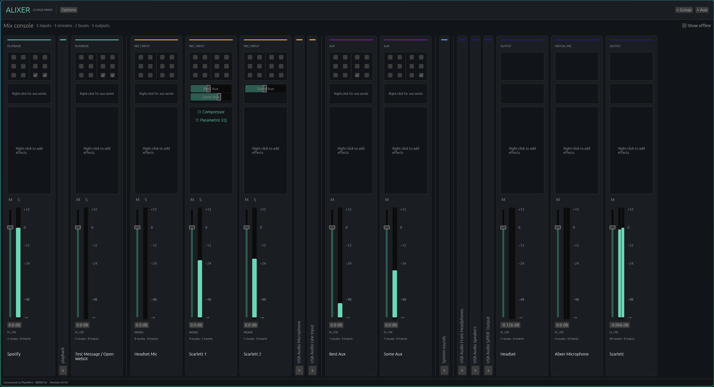
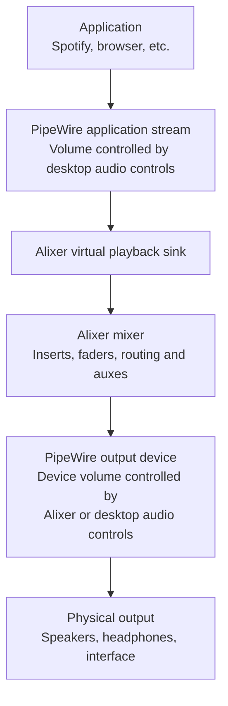
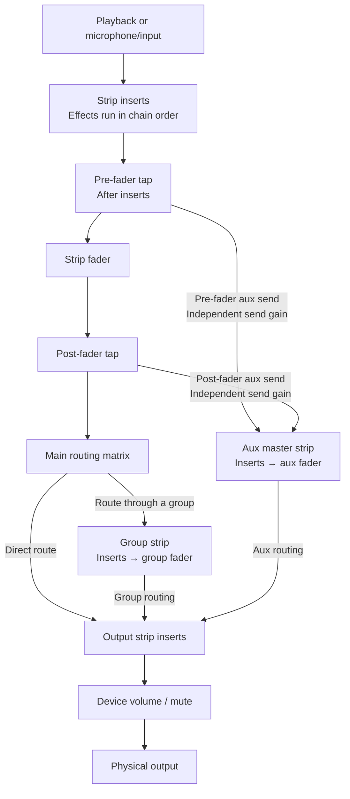

# Alixer - A Linux Mixer

A Rust mixing console for Linux, powered by PipeWire and WirePlumber with an
egui GUI.



- Channel strips for microphones, playback applications, groups, aux masters, and outputs.
- Per-channel routing, mute/solo, and pre/post-fader aux sends.
- Dedicated EQ, compressor and limiter editors, powered by LSP LV2 effects.
- A persistent audio service, independent of the GUI.
- A dark, customizable interface.

## Getting started

### Install an RPM

See the [RPM packaging guide](packaging/rpm/README.md) for builds, installation,
and per-user service activation. The first tested target is openSUSE Tumbleweed
x86_64.

### Run from source

```sh
cargo build --workspace
target/debug/alixer --dev-service
```

`--dev-service` starts the sibling `alixerd` binary and stops it when the GUI exits.
It refuses to take ownership of an already running service. Without this flag,
the GUI connects to the independently running service.

| Component | Executable / unit |
| --- | --- |
| Mixer GUI | `alixer` |
| Audio service | `alixerd` / `alixer.service` |
| Command-line client | `alixerctl` |

The service keeps audio running when the GUI closes. Its PipeWire graph sleeps
when no playback or connected, routed microphone inputs need processing. Metering
runs for GUI subscribers and explicit snapshot requests; unrouted microphone
preview connections are released when metering stops. Unrouted inputs use separate
preview filters, so opening or closing the GUI does not attach their capture
clocks to playback.
Playback sinks exist only while an application stream needs them, including while
paused. Saved strips keep their settings without leaving unused output devices.
Stopping or crashing the service releases playback to normal desktop routing
and removes its playback sinks. The virtual microphone stays silent on ordinary
shutdown so recording applications do not fall back to a hardware microphone.

To remove Alixer's audio setup entirely, see [Removing Alixer's audio integration](#removing-alixers-audio-integration).

## Signal flow

PipeWire provides application streams, devices and connections. Alixer adds its
own processing between application streams and output devices:



The application's stream volume and Alixer's playback fader are separate gain
stages. Both affect the audio, but changing one does not move the other. Physical
output faders control the same device volume as other desktop audio controls.

Inside Alixer, inserts process audio **before the strip fader**. Routing selects
which destinations receive each channel. Groups and aux masters have their own
insert chains and faders:



- **Pre-fader aux:** includes the source's effects, but ignores its fader position.
- **Post-fader aux:** includes those effects and follows the source fader.
- **Aux master inserts:** process the combined audio from its sends, for example
  a shared reverb.
- **Output fader:** controls device volume, after output-strip inserts.

Strip mute and solo also silence its pre-fader sends. Moving the strip fader
changes the processed output level without changing the input level driving its
compressor, gate or distortion. System sounds use separate paths to their
requested devices, as described below.

## Using the console

### Faders and layout

| Action | Control |
| --- | --- |
| Reset a fader to 0 dB | Double-click its handle |
| Adjust a fader at half speed | Hold Shift while dragging its handle |
| Zoom in / out / reset | `Ctrl` + `+` / `Ctrl` + `-` / `Ctrl` + `0` |
| Collapse a strip | Right-click its name or background → **Hide** |
| Restore a collapsed strip | Click **»** at its bottom |
| Rename a strip | Right-click its name or background → **Rename…** |
| Reorder strips | Drag a strip's name within its section |
| Restore default colors | **Options** → **Reset channel colors** |

### System sounds

The blue **System sounds** strip sits before the outputs. Its volume and mute
apply to streams tagged with the event/notification media role or an `event.id`.
Each sound keeps its requested device; the meter shows the loudest active event.
These sounds use independent processing paths to their requested devices, outside
the main mixer's insert graph, and have no routing, aux-send, solo, or effect controls. Untagged
sounds remain ordinary playback streams. Existing saved event strips are
consolidated automatically without changing other playback strips.

The WirePlumber integration applies saved controls before a short sound starts.
After updating a development build, run `alixerctl enable` again and restart
WirePlumber to refresh its script. Use the matching GUI and daemon binaries.

### Routing

When a routing change needs a decision, an amber **!** appears on the affected
channel, including collapsed and offline channels. Click it to compare the
detected connections with the saved routing and choose which to use. Normal
stream restarts and clear external moves are handled automatically.

The routing box at the top of each sending strip shows two destination pairs
per row (`□ □ | □ □`).

- Hover a checkbox to identify its destination and channel.
- Click to connect or disconnect that channel.
- **Show offline** reveals disconnected outputs.

Mono sources can feed both sides of a stereo destination. Output masters are
terminal: edit their incoming connections in the sending channel's routing box.

### Microphones and meetings

Microphones appear as amber **MIC / INPUT** strips. To use one in a meeting:

1. In its routing box, enable both channels of **Alixer Microphone** (hover to
   find them).
2. Select **Alixer Microphone** as the input device in your meeting application.
3. Use the microphone strip's fader, mute, and LV2 inserts to control your voice.

New microphones start unrouted. Route them to headphones only if you want to
monitor yourself; routing to speakers can cause feedback. The virtual microphone
works with the GUI closed and stays silent if the Alixer service stops.
Input faders control the Alixer signal; hardware microphone gain remains in your
system's input settings. Meeting applications using the hardware microphone
directly bypass Alixer's controls.

### Aux sends

The aux-send rack sits between routing and inserts.

1. Right-click empty space to create an aux master (`Aux1`, `Aux2`, …) and its
   send, or select an existing master. On a full rack, use **Add send…**.
2. Raise the send's horizontal fader. New sends start post-fader at −∞.
3. Route the aux master to the desired outputs. New masters have no outgoing
   routes selected.

Right-click a send to change between pre/post-fader mode or **Delete send**.
Deleting sends retains their master, even when none remain. To remove a master
and all its sends, right-click its bottom name → **Delete aux master**, or use
the same button in its inspector.

### LV2 inserts

Each strip has an insert rack above its buttons and fader.

- **Add:** right-click empty rack space → **Add effect…**, then choose Parametric EQ,
  Compressor or Limiter. Mono and stereo strips use the matching LSP implementation.
- **Edit:** click an insert to open its dedicated egui editor. Numeric values can
  be typed directly; double-click a slider to restore its default.
- **EQ:** select one of eight bands, drag its frequency/gain handle, and scroll
  over a handle to adjust Q. Filter type, algorithm, slope, width, solo and mute
  remain available. The plot shows an approximate filter response: mint for the combined curve and
  gold for the selected band. Q changes the curve width; muted/off bands are excluded.
  The preview uses common analog filter prototypes, so LSP algorithms and decramping
  may differ. Ladder filters are omitted from the preview.
- **Dynamics:** processing, timing, detector and signal controls are grouped by
  function, with live input/output meters and gain-change history.
- **Manage:** right-click an insert to bypass, reorder, or remove it.

Install the LSP **LV2** package for source builds (`lv2-lsp-plugins` on openSUSE,
`lsp-plugins-lv2` on Fedora). RPM installations require it automatically. Alixer
supports LSP Parametric Equalizer x8, Compressor and Limiter in mono/stereo;
external sidechain inputs and LSP link routing are not exposed. Multichannel
strips retain mixing and routing but cannot add these mono/stereo effects.
Other effects in existing sessions remain playable, with a generic fallback editor.

## Outputs

### Master strips and meters

Each output has a master strip. Use groups and auxes to build reusable mixes
and feed several outputs.

The fader and mute control the same native device settings used by desktop volume
controls. Meters show audio routed through Alixer before device volume and mute.

### Renaming outputs

Rename an output in its inspector to set its display name across audio
applications and desktop audio controls.

1. Enter the new name.
2. Choose **Apply output names…**.
3. Confirm **Restart WirePlumber**. Audio may briefly stop while devices reconnect.

**Reset name** removes Alixer's override; apply again to restore the original
system description. Names remain effective with Alixer closed. This supports
ALSA and Bluetooth outputs; custom virtual sinks must be renamed by their owner.

## Saved state and updates

Mixer state and GUI preferences are saved under `~/.local/state/alixer` (or
`$XDG_STATE_HOME/alixer`). Use `ALIXER_STATE_DIR` for an isolated state directory.
Restart the service after updating the binaries.

## Removing Alixer's audio integration

Close the GUI, then run this as your normal desktop user, without `sudo`:

```sh
alixerctl undeploy
```

This returns audio to normal desktop routing and:

- Stops and disables the Alixer service, including a manually started daemon.
- Removes Alixer's virtual playback devices, processing nodes and virtual
  microphone.
- Clears Alixer's routing metadata and default-device references to its devices.
- Removes its per-user WirePlumber integration and output-name rules.
- Reloads user service definitions and restarts WirePlumber to apply the cleanup.

Audio may briefly pause while WirePlumber restarts. Applications using **Alixer
Microphone** return to desktop recording policy; select the desired microphone
in those applications afterward.

Saved mixer settings and GUI preferences are retained. Current hardware device
volumes and unrelated desktop settings are preserved; this does not restore a
snapshot of the system from before Alixer was installed. The application binaries
remain installed, so you can uninstall the package after running the command.

Simply closing the GUI leaves the audio service running. Stopping the service
returns playback to desktop routing, but retains the silent virtual microphone
to prevent recording applications from unexpectedly switching to a hardware
microphone. Use `undeploy` to remove that endpoint and the integration too.

## Development and verification

### Workspace and runtime tests

```sh
cargo test --workspace
cargo build --workspace
python3 tests/runtime.py --offline
python3 tests/runtime.py
python3 tests/capture.py
python3 tests/system_sounds.py
```

Runtime tests start private PipeWire, WirePlumber, and D-Bus instances with
temporary config, runtime, and state directories. They do not change desktop audio
configuration. Live tests require their executables, `pipewire-pulse`, `pactl`,
`wpctl`, `pw-cli`, `pw-dump`, `pw-play`, `pw-record`, `paplay`, and a C compiler (`cc`)
for the test-only LV2 fixture. The live test checks uninterrupted playback and
plugin lifetime while unrelated streams open and close, suspension before and
after playback, idle CPU use, and microphone preview cleanup after UI disconnects.

### Native LV2 tests

The native LV2 test requires `ALIXER_LILV_LIBRARY` to point to an
installed Lilv shared library. It builds and hosts a test plugin with controls,
a worker, and saved state. Without that variable, this optional test is skipped.

To test against real LSP binaries, set `ALIXER_LSP_LV2_PATH` to the directory
containing their `.lv2` bundle and `ALIXER_LILV_LIBRARY` to Lilv, then run:

```sh
cargo test -p alixer-lv2 --test lsp -- --nocapture
```
